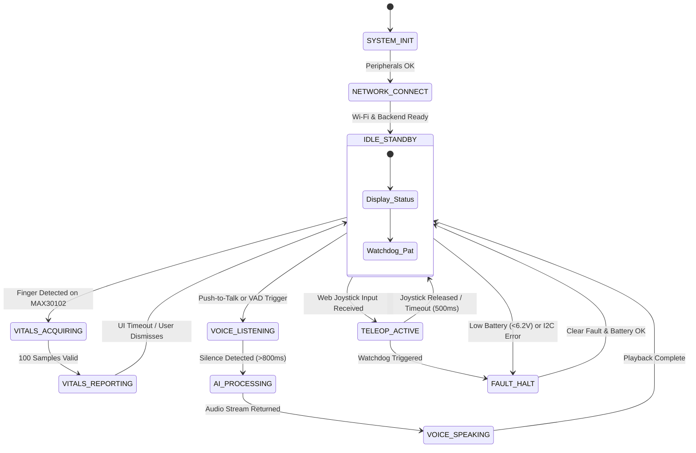

# System Design Document: Smart Healthcare Assistant Robot Using ESP32-S3

---

## 1. Executive Summary & Design Scope

The **Smart Healthcare Assistant Robot** is an interactive, battery-powered cyber-physical system designed to operate in clinical and domestic healthcare environments. The system integrates five primary functional pillars:
1. **Interactive Conversational AI**: Natural voice interface for patient comfort, basic symptom intake, and reminders.
2. **Vital Signs Monitoring (PPG)**: Continuous or on-demand acquisition of Heart Rate (BPM) and peripheral oxygen saturation ($\text{SpO}_2$).
3. **Local Visual Human-Machine Interface (HMI)**: High-contrast OLED display providing immediate visual feedback, animated facial expressions, and health diagnostics.
4. **Teleoperated Mobility**: Low-latency, differential drive actuation governed via a responsive web application served directly from the microcontroller.
5. **Robust Power & Safety Infrastructure**: Multi-rail regulated power architecture featuring hardware battery protection, electrical isolation, and software watchdog failsafes.

---

## 2. System Requirements & Specifications

### 2.1 Functional Requirements
- **FR-01 (Voice Intake)**: Capture ambient human speech at 16 kHz / 16-bit mono PCM via an omnidirectional digital MEMS microphone with signal-to-noise ratio (SNR) $\ge 61\text{ dBA}$.
- **FR-02 (AI Conversation)**: Transmit digitised voice streams to an external processing backend, receive synthetic speech responses, and reproduce high-intelligibility audio ($>75\text{ dBA}$ at 1 meter).
- **FR-03 (Physiological Sensing)**: Sample Red and Infrared reflectance photoplethysmography (PPG) waveforms at $\ge 100\text{ Hz}$ to extract pulse rate ($30 - 220\text{ BPM} \pm 2\text{ BPM}$) and estimate $\text{SpO}_2$ ($70\% - 100\% \pm 3\%$).
- **FR-04 (Mobility Control)**: Provide directional navigation (Forward, Reverse, Left Turn, Right Turn, Spin, Stop) with smooth variable speed control using dual PWM channels.
- **FR-05 (Web Portal)**: Host an onboard HTTP/WebSocket server capable of rendering an interactive touch controller on any modern smartphone browser without requiring native app installations.

### 2.2 Non-Functional & Safety Requirements
- **NFR-01 (Low Latency)**: Motor control command-to-actuation latency $< 80\text{ ms}$; Voice conversational turn-around latency $< 2.5\text{ s}$ over broadband Wi-Fi.
- **NFR-02 (Acoustic Isolation)**: Acoustic feedback prevention between speaker output and microphone capsule via mechanical dampening and software half-duplex gating.
- **NFR-03 (Motor Safety Timeout)**: Automated dead-man failsafe—motors must automatically brake if no teleoperation command is received for $> 500\text{ ms}$.
- **NFR-04 (Thermal & Current Limits)**: Maximum continuous current draw $< 2.0\text{ A}$ from the battery pack; motor driver heatsink temperature $< 65^\circ\text{C}$.

---

## 3. Hardware Architecture & Electrical Design

### 3.1 Power Distribution Network (PDN)

The robot is powered by a **2S Lithium-Ion battery pack** (nominal voltage: $7.4\text{ V}$, fully charged: $8.4\text{ V}$, end-of-discharge cut-off: $6.0\text{ V}$). 

```
+-----------------------------------------------------------------------------------------+
|                                2S Li-ion Battery (7.4V - 8.4V)                         |
+-----------------------------------------------------------------------------------------+
                                             |
                                 [2S 8A BMS Protection Circuit]
                                 (Over-charge, Over-discharge, Short)
                                             |
                                    [2.5A Fast-Acting Fuse]
                                             |
                                   [Master SPST Switch]
                                             |
                     +-----------------------+-----------------------+
                     |                                               |
             [Motor High-Rail]                              [Buck Converter]
                     |                                  (MP1584 / LM2596 Reg.)
                     v                                               | (Fixed 5.00V @ 3A)
         +-----------------------+                                   v
         |   L298N VMS Pin       |                   +---------------+---------------+
         |   (7.4V - 8.4V Unreg) |                   |                               |
         +-----------------------+                   v                               v
                     |                    +--------------------+           +--------------------+
                     v                    | ESP32-S3 VIN (5V)  |           | MAX98357A VIN (5V) |
             +---------------+            +--------------------+           +--------------------+
             | 2x TT Motors  |                       |
             +---------------+            [Internal 3.3V LDO]
                                                     |
                                   +-----------------+-----------------+
                                   |                 |                 |
                                   v                 v                 v
                              +---------+       +----------+      +---------+
                              | INMP441 |       | MAX30102 |      | SSD1306 |
                              +---------+       +----------+      +---------+
```

#### Power Budget Breakdown
| Component | Operating Rail | Typical Current | Peak Current | Peak Power |
|---|---|---|---|---|
| **ESP32-S3 (Wi-Fi TX Active)** | 5.0V (Internal 3.3V) | 120 mA | 380 mA | 1.90 W |
| **INMP441 Digital Mic** | 3.3V | 1.4 mA | 2.0 mA | 0.007 W |
| **MAX98357A + 4Ω Speaker** | 5.0V | 100 mA | 800 mA | 4.00 W |
| **MAX30102 PPG Sensor** | 3.3V | 1.2 mA | 50 mA (LEDs pulsing)| 0.165 W |
| **SSD1306 OLED (All Pixels On)**| 3.3V | 20 mA | 35 mA | 0.115 W |
| **2x TT Geared Motors (Loaded)**| 7.4V (Raw) | 400 mA | 1200 mA | 8.88 W |
| **Total System (Worst Case)** | — | **~640 mA** | **~2467 mA** | **~15.06 W** |

*Estimated Run Time*: With two $2600\text{ mAh}$ 18650 cells in series ($19.24\text{ Wh}$), under average load ($750\text{ mA} @ 7.4\text{ V} \approx 5.55\text{ W}$), typical continuous operational endurance is **$3.2 - 3.8\text{ hours}$**.

---

### 3.2 Audio Subsystem Design (I2S DMA)

The ESP32-S3 contains two independent hardware I2S peripherals: `I2S_NUM_0` and `I2S_NUM_1`. 

#### Clocking Architecture
For high-fidelity digital audio at standard sample rate $F_s = 16,000\text{ Hz}$ with $N = 16\text{ bits}$ per channel over 2 audio slots (stereo frame):
$$\text{Bit Clock (BCLK)} = F_s \times N \times 2 = 16,000 \times 16 \times 2 = 512,000\text{ Hz } (512\text{ kHz})$$
$$\text{Word Select (WS / LRCK)} = F_s = 16,000\text{ Hz}$$

#### Pin Assignment Strategy
To simplify line routing and allow half-duplex conversational flow:
- `BCLK` (`GPIO 4`) is tied to both INMP441 `SCK` and MAX98357A `BCLK`.
- `WS` (`GPIO 5`) is tied to both INMP441 `WS` and MAX98357A `LRC`.
- Microphone data stream `SD` is connected to ESP32-S3 `GPIO 6` (I2S DMA RX Data).
- Speaker data stream `DIN` is connected to ESP32-S3 `GPIO 7` (I2S DMA TX Data).

```
                      +-------------------+
                      |     ESP32-S3      |
                      |                   |
                      |  GPIO 4 (BCLK) ---+--------+--------> INMP441 SCK
                      |                   |        |
                      |  GPIO 5 (WS) -----+---+    |--------> MAX98357A BCLK
                      |                   |   |    |
                      |  GPIO 6 (DIN_RX) <----+----+--------> INMP441 SD
                      |                   |   |
                      |  GPIO 7 (DOUT_TX) +---+-------------> MAX98357A DIN
                      +-------------------+   |
                                              +-------------> INMP441 WS & MAX98357A LRC
```

> [!NOTE]
> **Half-Duplex Audio Operation**: During speech capture, the speaker channel is muted (`I2S TX` idle / amplifier shutdown). During response playback, the microphone stream is gated off in software. This completely eliminates acoustic feedback loops and speaker-induced microphone clipping.

---

### 3.3 Physiological Sensing Subsystem (MAX30102 Optical PPG)

The MAX30102 operates via dual optical emitters:
- **Red LED ($\lambda = 660\text{ nm}$)**: Highly absorbed by deoxygenated hemoglobin ($\text{Hb}$).
- **Infrared LED ($\lambda = 880\text{ nm}$)**: Highly absorbed by oxygenated hemoglobin ($\text{HbO}_2$).

```
                      Photodetector Surface
                              |
       +----------------------+----------------------+
       |                                             |
   [Red LED 660nm]                           [IR LED 880nm]
       |                                             |
       v                                             v
   +-----------------------------------------------------+
   |                 Human Capillary Bed                 |
   |              (Finger / Ear / Forehead)              |
   +-----------------------------------------------------+
```

#### Ratio-of-Ratios Mathematical Formulation
The photoplethysmographic signal consists of a large DC baseline (quiescent tissue, bone, venous blood) and an alternating AC component (pulsatile arterial blood):
$$R = \frac{\left( \frac{AC_{660}}{DC_{660}} \right)}{\left( \frac{AC_{880}}{DC_{880}} \right)}$$
The peripheral blood oxygen saturation is estimated empirically using standard calibration polynomials:
$$\text{SpO}_2 (\%) = -45.060 \cdot R^2 + 30.354 \cdot R + 94.845$$
*(or linear approximation $\text{SpO}_2 = 110 - 25 \cdot R$ for initial triage ranges)*.

#### I2C Bus Configuration
- **Bus Speed**: Fast Mode ($400\text{ kHz}$) to enable low-latency reading of the 32-sample internal FIFO.
- **Bus Sharing**: Connected to `GPIO 8` (SDA) and `GPIO 9` (SCL) with shared hardware pull-ups ($4.7\text{ k}\Omega$).
  - MAX30102 Address: `0x57`
  - SSD1306 OLED Address: `0x3C`
  - *No address collision occurs.*

---

### 3.4 Motor Drive Subsystem & Actuation Dynamics

The robot employs a **differential drive kinematic configuration** driven by two independent yellow TT geared DC motors ($1:48$ gear ratio, rated $3\text{V} - 6\text{V}$).

#### L298N Interfacing Logic
```
Direction State    IN1    IN2    IN3    IN4    ENA (PWM)    ENB (PWM)
---------------------------------------------------------------------
FORWARD            HIGH   LOW    HIGH   LOW    Speed (0-255) Speed (0-255)
REVERSE            LOW    HIGH   LOW    HIGH   Speed (0-255) Speed (0-255)
PIVOT LEFT         LOW    HIGH   HIGH   LOW    Turn Speed    Turn Speed
PIVOT RIGHT        HIGH   LOW    LOW    HIGH   Turn Speed    Turn Speed
ACTIVE BRAKE       HIGH   HIGH   HIGH   HIGH   255           255
COAST / IDLE       LOW    LOW    LOW    LOW    0             0
```

#### PWM Generation (LEDC Peripheral)
- **PWM Frequency**: $5,000\text{ Hz}$ (5 kHz eliminates acoustic motor whining while remaining well within L298N switching rise-time limits).
- **Resolution**: 8-bit ($0 - 255$ steps) mapped to ESP32-S3 LEDC Channel 0 (Left) and Channel 1 (Right).
- **Flyback Protection**: L298N contains onboard 1N4007 flyback diodes to clamp inductive motor kickback spikes.

---

## 4. Software & Firmware Architecture

### 4.1 FreeRTOS Task Scheduling & Core Pinning

The ESP32-S3 runs two physical cores (`Core 0` and `Core 1`) clocked at $240\text{ MHz}$. Tasks are explicitly pinned to prevent priority inversion and avoid Wi-Fi interrupt contention:

```
+-----------------------------------------------------------------------------------+
|                                 ESP32-S3 SOC DUAL CORE                             |
+-----------------------------------------------------------------------------------+
|               CORE 0 (Networking & Comms)        |    CORE 1 (Sensing & Actuation) |
+--------------------------------------------------+--------------------------------+
| - Wi-Fi Protocol Stack (LwIP)                    | - Task_Vitals (Pri 3, 100 Hz)  |
| - Task_WebServer (Pri 2, Async HTTP/WS)          |   * I2C FIFO polling           |
| - Task_AudioStream (Pri 5, DMA Buffer Management)|   * Peak detection & SpO2      |
|   * Mic I2S Read & WebSocket TX                  | - Task_MotorControl (Pri 4)    |
|   * Audio Response RX & I2S Write                |   * PWM ramping                |
| - Task_TelemetryDispatcher (Pri 1)               |   * Dead-man Watchdog          |
|                                                  | - Task_OLED_UI (Pri 2, 20 Hz)  |
+--------------------------------------------------+--------------------------------+
```

### 4.2 System Finite State Machine (FSM)



---

## 5. Cloud & Edge AI Backend Design

Because processing large transformer models (STT, LLM, TTS) exceeds the onboard SRAM and processing power of the ESP32-S3, an external compute node (Local Laptop or Cloud VM) serves as the **AI Cognitive Gateway**.

```
+----------------+            Wi-Fi (TCP / WebSocket)           +-----------------------+
|    ESP32-S3    | <==========================================> |   Python AI Gateway   |
|  Edge Robot    |                                              |  (FastAPI / asyncio)  |
+----------------+                                              +-----------------------+
   | (16kHz PCM)                                                    |        |       |
   v                                                                |        |       |
[INMP441 Stream] ---------------------------------------------------+        |       |
                                                                             v       |
                                                                    +-------------+  |
                                                                    | Whisper STT |  |
                                                                    +-------------+  |
                                                                             |       |
                                                                     (Transcribed)   |
                                                                             v       v
                                                                    +-------------+  |
                                                                    | Gemini / LLM|  |
                                                                    +-------------+  |
                                                                             |       |
                                                                     (Synthesized)   |
                                                                             v       |
                                                                    +-------------+  |
                                                                    | Piper / TTS | -+
                                                                    +-------------+
                                                                             |
[MAX98357A Spk] <-----------------(16kHz 16-bit PCM Stream)-----------------+
```

### 5.1 Pipeline Stages
1. **Audio Ingestion**: ESP32-S3 records microphone buffers into a FreeRTOS circular ring buffer and streams chunks over a binary WebSocket connection.
2. **Speech-to-Text (STT)**:
   - *Local*: `Faster-Whisper` (base.en model) running on CUDA/CPU.
   - *Cloud*: Google Cloud Speech-to-Text API / OpenAI Whisper API.
3. **Conversational Intelligence (LLM)**:
   - System Prompt enforces medical assistant persona: concise answers ($< 40\text{ words}$), empathetic tone, and mandatory clinical disclaimers.
4. **Text-to-Speech (TTS)**:
   - *Local*: `Piper-TTS` (super-fast, low-latency ONNX neural voice).
   - *Cloud*: `Edge-TTS` (natural human inflection, streamed in real time).
5. **Transcoding & Streaming**: Audio synthesized at 16,000 Hz 16-bit mono PCM is pushed directly back across the WebSocket to the ESP32-S3 I2S DMA queue.

---

## 6. Teleoperation Web Interface Design

The ESP32-S3 runs an embedded asynchronous web server hosting a lightweight, single-page application (SPA):
- **Zero-Dependency Vanilla Web Stack**: Pure HTML5, CSS3, and JavaScript, stored compressed in SPIFFS/LittleFS or embedded as a C++ header string literal.
- **Controls**:
  - Touch-friendly directional D-Pad / virtual analog joystick.
  - Speed throttling slider ($30\% - 100\%$).
  - Real-time Vitals Monitor (Live BPM & $\text{SpO}_2$ badge).
  - Voice Interaction Trigger ("Tap to Speak" / Voice Assistant Status).
  - Emergency Stop (`ESTOP`) button overriding all motor registers.

---

## 7. Acoustic & Mechanical Engineering

### 7.1 Acoustic Isolation Design
- The INMP441 MEMS microphone port must be mechanically isolated from the speaker enclosure using a silicone grommet.
- The 4Ω speaker must be housed in an airtight 3D-printed acoustic cavity to maximize bass response and prevent structural sound conduction into the chassis.

### 7.2 Chassis Layout & Weight Distribution
- The heavy 2S 18650 battery pack is positioned low and centered over the drive axle to optimize traction and prevent wheel slip.
- The caster wheel is placed rearward to maintain a stable 3-point tripod contact plane on hospital flooring.
- The MAX30102 sensor is oriented on an accessible upper shelf with a contoured finger cradle to minimize ambient light leakage and motion artifacts.

---

## 8. Verification & Test Plan

| Test ID | Test Scenario | Acceptance Criteria |
|---|---|---|
| **VT-01** | Power Rail Voltage Regulation | Buck output measures $5.00\text{ V} \pm 0.05\text{ V}$ across $0\text{ A}$ to $2.5\text{ A}$ load transient. |
| **VT-02** | I2C Device Enumeration | I2C scan consistently detects `0x3C` (OLED) and `0x57` (MAX30102) without bus timeouts. |
| **VT-03** | Motor Failsafe Timeout | Motors stop within $\le 520\text{ ms}$ upon disconnection of client teleoperation signal. |
| **VT-04** | Heart Rate Correlation | MAX30102 measured BPM matches reference pulse oximeter within $\pm 3\text{ BPM}$ across 10 trials. |
| **VT-05** | Audio Conversational Roundtrip | Total time from end of user utterance to speaker audio onset $\le 2.8\text{ seconds}$. |
| **VT-06** | Thermal Stress Run | Continuous 30-minute teleoperation run shows L298N heatsink temperature $< 60^\circ\text{C}$. |
