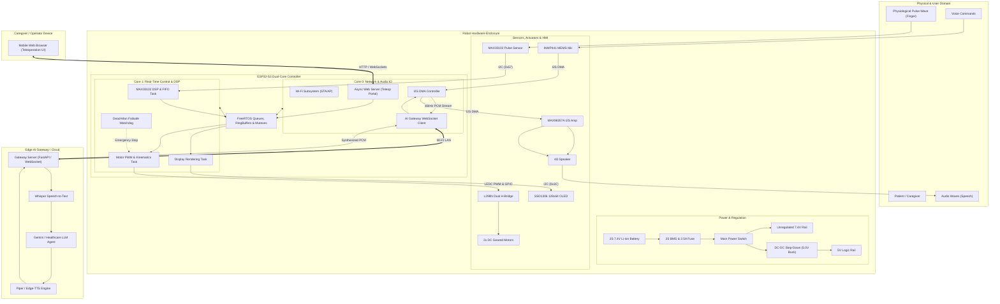

# System Architecture Document: Smart Healthcare Assistant Robot (ESP32-S3)

---

## 1. Architectural Blueprint & High-Level System Topology

The Smart Healthcare Assistant Robot follows a **distributed edge-cloud embedded architecture**. The physical robot acts as an intelligent real-time cyber-physical node, while intensive speech-to-text, cognitive reasoning (LLM), and neural voice synthesis are offloaded to an edge-compute gateway or cloud service.



---

## 2. Hardware Signal & Bus Interconnect Architecture

```
                             +------------------------+
                             |   ESP32-S3 Microcontroller |
                             +------------------------+
                               |     |     |     |
              +----------------+     |     |     +----------------+
              | (I2S Bus)            |     |            (I2C Bus) |
              v                      v     |                      v
   +---------------------+   +-----------+ |            +---------------------+
   | Audio Subsystem     |   | Motor PWM | |            | Sensors & Display   |
   | - INMP441 Mic       |   | & GPIO    | |            | - MAX30102 (0x57)   |
   |   SCK: GPIO 4       |   |           | |            | - SSD1306 (0x3C)    |
   |   WS:  GPIO 5       |   | IN1: GPIO10 |            | SDA: GPIO 8         |
   |   SD:  GPIO 6 (RX)  |   | IN2: GPIO11 |            | SCL: GPIO 9         |
   | - MAX98357A Amp     |   | IN3: GPIO12 |            +---------------------+
   |   BCLK: GPIO 4      |   | IN4: GPIO13 |
   |   LRC:  GPIO 5      |   | ENA: GPIO14 (PWM0)
   |   DIN:  GPIO 7 (TX) |   | ENB: GPIO15 (PWM1)
   +---------------------+   +-----------+
```

### Complete Hardware Pin Mapping Table

| GPIO Pin | Function / Peripheral | Connected Device | Protocol / Signal Type | Description |
|---|---|---|---|---|
| **GPIO 4** | `I2S0_BCLK` | INMP441 & MAX98357A | Digital Clock (512 kHz) | Continuous Serial Bit Clock for Audio |
| **GPIO 5** | `I2S0_WS` / `LRC` | INMP441 & MAX98357A | Digital Clock (16 kHz) | Word Select / Frame Sync (Left/Right) |
| **GPIO 6** | `I2S0_DIN` | INMP441 `SD` Pin | Digital Serial Data In | Audio Data Stream from Microphone |
| **GPIO 7** | `I2S0_DOUT` | MAX98357A `DIN` Pin | Digital Serial Data Out| Synthesized Audio Stream to Speaker |
| **GPIO 8** | `I2C0_SDA` | MAX30102 & SSD1306 | Digital Bidirectional | I2C Data (4.7kΩ Pull-up to 3.3V) |
| **GPIO 9** | `I2C0_SCL` | MAX30102 & SSD1306 | Digital Clock (400 kHz)| I2C Clock (4.7kΩ Pull-up to 3.3V) |
| **GPIO 10**| `GPIO_OUTPUT` | L298N `IN1` | Logic High/Low | Left Motor Direction Bit 1 |
| **GPIO 11**| `GPIO_OUTPUT` | L298N `IN2` | Logic High/Low | Left Motor Direction Bit 2 |
| **GPIO 12**| `GPIO_OUTPUT` | L298N `IN3` | Logic High/Low | Right Motor Direction Bit 1 |
| **GPIO 13**| `GPIO_OUTPUT` | L298N `IN4` | Logic High/Low | Right Motor Direction Bit 2 |
| **GPIO 14**| `LEDC_CH0` | L298N `ENA` | Hardware PWM (5 kHz) | Left Motor Speed Control |
| **GPIO 15**| `LEDC_CH1` | L298N `ENB` | Hardware PWM (5 kHz) | Right Motor Speed Control |
| **GPIO 21**| `GPIO_INPUT` | MAX30102 `INT` | Active Low Interrupt | Optional Data-Ready PPG Interrupt |

---

## 3. Microcontroller Firmware Architecture (FreeRTOS Multi-Core)

The firmware is designed around **FreeRTOS** on the ESP-IDF / Arduino core, strictly dividing tasks across the two asymmetric Xtensa cores to ensure hard real-time motor control and sensor acquisition are never starved by Wi-Fi network stacks.

```
+====================================================================================================+
|                                    ESP32-S3 FREERTOS OS SCHEDULER                                  |
+====================================================================================================+
| CORE 0: Network Protocol Stack & Audio Transport       | CORE 1: Hard Real-Time Control & Hardware |
+--------------------------------------------------------+-------------------------------------------+
| [Task_WiFi & LwIP Stack]                               | [Task_MotorControl] (Priority: 5)         |
|  - System Wi-Fi Station & SoftAP driver                |  - Consumes MotorCommandQueue             |
|                                                        |  - Adjusts LEDC PWM & H-Bridge GPIOs      |
| [Task_AudioNetwork] (Priority: 4)                      |  - Updates dead-man watchdog timer        |
|  - Reads from AudioTxRingBuffer (Mic -> Cloud)         |                                           |
|  - Writes to AudioRxRingBuffer (Cloud -> Speaker)      | [Task_Vitals] (Priority: 4)               |
|                                                        |  - Polls MAX30102 FIFO at 100 Hz          |
| [Task_AsyncWebServer] (Priority: 2)                    |  - Runs DSP (Bandpass, Peak, SpO2)        |
|  - Serves static HTML5/CSS/JS frontend                 |  - Dispatches to VitalsEventQueue         |
|  - Handles WebSocket telemetry & joystick input        |                                           |
|                                                        | [Task_OLED_UI] (Priority: 2)              |
| [Task_Telemetry] (Priority: 1)                         |  - Updates display buffer at 20 FPS       |
|  - Broadcasts JSON vitals & battery status             |  - Displays animations & heart rate pulse |
+====================================================================================================+
```

### FreeRTOS Task Manifest

| Task Identifier | Assigned Core | Priority | Stack Size | Periodicity | Responsibilities |
|---|---|---|---|---|---|
| `Task_MotorControl` | Core 1 | 5 (High) | 4096 bytes | Event-driven ($\le 10\text{ ms}$) | Translates movement commands into PWM duty cycles; safety stops |
| `Task_Vitals` | Core 1 | 4 (Med-High)| 4096 bytes | Periodic ($10\text{ ms} / 100\text{ Hz}$) | MAX30102 sample retrieval, PPG DC filtering, HR/SpO2 calculation |
| `Task_AudioNetwork`| Core 0 | 4 (Med-High)| 8192 bytes | Stream-driven ($\sim 32\text{ ms}$) | Bi-directional streaming of 512-sample PCM chunks over WebSockets |
| `Task_AudioDriver` | Core 0 | 3 (Medium) | 4096 bytes | DMA callback driven | Feeds I2S peripheral with outgoing audio; drains microphone DMA |
| `Task_AsyncWebServer`| Core 0 | 2 (Low) | 6144 bytes | Event-driven (Async) | Serves web assets, decodes client touch joystick WebSocket packets |
| `Task_OLED_UI` | Core 1 | 2 (Low) | 3072 bytes | Periodic ($50\text{ ms} / 20\text{ Hz}$) | Renders vitals text, battery gauge, and dynamic facial expressions |
| `Task_Watchdog` | Core 1 | 6 (Critical)| 2048 bytes | Periodic ($50\text{ ms}$) | Validates packet freshness; triggers emergency brake on timeout |

---

## 4. Audio Pipeline & Conversational Architecture

```
[PATIENT SPEAKS]
       |
       v
+--------------+     I2S DMA Rx Buffer     +------------------------+
|   INMP441    | ------------------------> | ESP32-S3 Audio Driver  |
|  Microphone  | (16 kHz, 16-bit Mono PCM) | (Ping-Pong DMA Buffers)|
+--------------+                           +------------------------+
                                                       |
                                            Voice Activity Detection
                                            (Local Energy Threshold)
                                                       |
                                                       v
                                           +------------------------+
                                           |  AudioTxRingBuffer     |
                                           |  (32 KB Circular RAM)  |
                                           +------------------------+
                                                       |
                                              WebSocket Binary Push
                                                       |
                                                       v
                                           +------------------------+
                                           | External AI Gateway    |
                                           | (FastAPI / Node Server)|
                                           +------------------------+
                                              |       |       |
                 +----------------------------+       |       +-------------------------+
                 |                                    |                                 |
                 v                                    v                                 v
        +-------------------+                +-------------------+             +-------------------+
        |  1. Whisper STT   |                | 2. LLM Reasoning  |             |  3. Piper / TTS   |
        |  Transcribes voice| -------------> | Generates medical | ----------> | Synthesizes voice |
        |  stream to text   |                | response (<40 wds)|             | to 16kHz PCM stream|
        +-------------------+                +-------------------+             +-------------------+
                                                                                        |
                                                                              WebSocket Binary Stream
                                                                                        |
                                                                                        v
                                           +------------------------+        +---------------------+
                                           | ESP32-S3 Audio Ingest  | -----> | AudioRxRingBuffer   |
                                           | (WebSocket Client)     |        | (32 KB Circular RAM)|
                                           +------------------------+        +---------------------+
                                                                                        |
                                                                               I2S DMA Tx Buffer
                                                                                        |
                                                                                        v
                                                                             +---------------------+
                                                                             | MAX98357A I2S DAC   |
                                                                             | + 4Ω 3W Speaker     |
                                                                             +---------------------+
                                                                                        |
                                                                                        v
                                                                                [PATIENT LISTENS]
```

### Acoustic Echo & Turn-Taking Arbitration
To maintain clarity with minimum hardware complexity:
1. **Half-Duplex Token Arbiter**: When the robot is in `STATE_SPEAKING`, the microphone DMA acquisition is paused or zeroed out to prevent the robot from listening to its own voice.
2. **Post-Speech Hang Time**: A $400\text{ ms}$ silent guard band is enforced after speech playback terminates before transitioning back to `STATE_LISTENING`.

---

## 5. Physiological Signal Processing Pipeline (PPG)

The MAX30102 provides raw 18-bit photodetector sample values for Red ($660\text{ nm}$) and Infrared ($880\text{ nm}$) light at $100\text{ samples/sec}$.

```
Raw Red & IR Photodiode Data
             |
             v
+-------------------------------------+
| 1. High-Pass Filter (DC Baseline)   | ---> Eliminates ambient light & steady tissue absorption
|    y[n] = x[n] - x[n-1] + a * y[n-1]|      (Corner frequency fc = 0.5 Hz)
+-------------------------------------+
             |
             v
+-------------------------------------+
| 2. Low-Pass Filter (High-Freq Noise)| ---> Removes 50/60 Hz mains interference & EMG muscle tremor
|    fc = 4.0 Hz (240 BPM cutoff)     |
+-------------------------------------+
             |
             +---------------------------------------+
             |                                       |
             v                                       v
+-----------------------------------+   +------------------------------------+
| 3. Peak Detection (Heart Rate)    |   | 4. Ratio-of-Ratios (SpO2)          |
|  - Dynamic amplitude thresholding |   |  - RMS calculation of AC red & IR  |
|  - Inter-beat interval (IBI, ms)  |   |  - DC average calculation          |
|  - BPM = 60000 / IBI              |   |  - R = (AC_red/DC_red)/(AC_ir/DC_ir|
|  - 5-sample median filter         |   |  - SpO2 = 110 - 25 * R             |
+-----------------------------------+   +------------------------------------+
             |                                       |
             +-------------------+-------------------+
                                 |
                                 v
                +---------------------------------+
                | Validated Vitals Data Packet    |
                | (BPM: 72, SpO2: 98%, Status: OK)|
                +---------------------------------+
```

---

## 6. Teleoperation & Mobility Architecture

```
Mobile Web Browser (User)
       |
       | (Touch Movement Coordinates: x, y [-100 .. +100])
       v
WebSocket Endpoint: ws://192.168.4.1/ws/control
       |
       v
+-------------------------------------+
| ESP32-S3 Async WebSocket Handler    |
| (Validates JSON schema & timestamp) |
+-------------------------------------+
       |
       | MotorCommandMsg (vx, vz, timestamp)
       v
+-------------------------------------+
| MotorCommandQueue (FreeRTOS)        |
+-------------------------------------+
       |
       v
+-------------------------------------------------------------+
| Task_MotorControl (Core 1)                                  |
| 1. Evaluates Watchdog: (now - timestamp) < 500 ms?          |
|    - If FALSE -> Emergency Stop!                            |
| 2. Differential Drive Kinematic Mapping:                    |
|    - V_left  = vx + (vz * TrackWidth / 2)                   |
|    - V_right = vx - (vz * TrackWidth / 2)                   |
| 3. Clamps values to [-255 .. +255]                          |
| 4. Software Acceleration Ramping (Prevents gear stripping)  |
| 5. Sets Direction GPIOs (IN1..IN4) & LEDC PWM Duty (ENA/ENB)|
+-------------------------------------------------------------+
       |
       v
+-------------------------------------+
| L298N Dual H-Bridge Driver          |
+-------------------------------------+
       |
       v
Left & Right TT Geared Motors
```

---

## 7. Failsafe, Watchdog & Fault Tolerant Strategy

```
                                  +-----------------------+
                                  | System Health Monitor |
                                  +-----------------------+
                                              |
             +--------------------------------+--------------------------------+
             |                                |                                |
             v                                v                                v
+--------------------------+    +--------------------------+    +--------------------------+
| Teleoperation Watchdog   |    | Battery Voltage Monitor  |    | I2C Bus Hang Recovery    |
+--------------------------+    +--------------------------+    +--------------------------+
| - Heartbeat every 200 ms |    | - Continuous ADC read    |    | - Monitored by timeout   |
| - If no packet > 500 ms: |    | - If V_pack < 6.2 V:     |    | - If SCL held LOW:       |
|   * PWM Duty -> 0        |    |   * Stop all motors      |    |   * Clock 9 dummy cycles |
|   * IN1..IN4 -> HIGH     |    |   * Audio: "Low Battery" |    |   * Generate STOP frame  |
|     (Active Dynamic      |    |   * Enter Light Sleep    |    |   * Reinitialize bus     |
|      Motor Braking)      |    +--------------------------+    +--------------------------+
+--------------------------+
```

---

## 8. Directory & Firmware Module Structure

```
nexathon/
├── README.md               # Quickstart, wiring tables, and BOM
├── design.md               # Electrical and mechanical design specifications
├── architer.md             # Complete system architecture and pipeline document
├── firmware/               # ESP32-S3 Arduino / PlatformIO source code
│   ├── platformio.ini      # Build configurations, library dependencies, partition maps
│   ├── include/
│   │   ├── config.h        # Pin assignments, network credentials, task parameters
│   │   ├── audio_i2s.h     # I2S DMA driver and circular ring buffer wrappers
│   │   ├── vitals_dsp.h    # MAX30102 acquisition, filters, and SpO2 formulas
│   │   ├── motor_driver.h  # L298N direction control and LEDC PWM ramps
│   │   └── web_server.h    # Async web server and teleoperation WebSocket handler
│   └── src/
│       ├── main.cpp        # FreeRTOS setup, core task pinning, and scheduler launch
│       ├── audio_i2s.cpp   # Audio stream processing routines
│       ├── vitals_dsp.cpp  # Real-time PPG signal conditioning
│       ├── motor_driver.cpp# Motor actuation and watchdog handler
│       └── web_server.cpp  # Web UI hosting and WebSocket dispatch
└── backend/                # External AI Gateway
    ├── server.py           # FastAPI WebSocket gateway
    ├── stt_engine.py       # Whisper speech recognition interface
    ├── llm_agent.py        # Conversational healthcare prompt & reasoning
    ├── tts_engine.py       # Piper / Edge-TTS audio synthesizer
    └── requirements.txt    # Python dependencies
```
